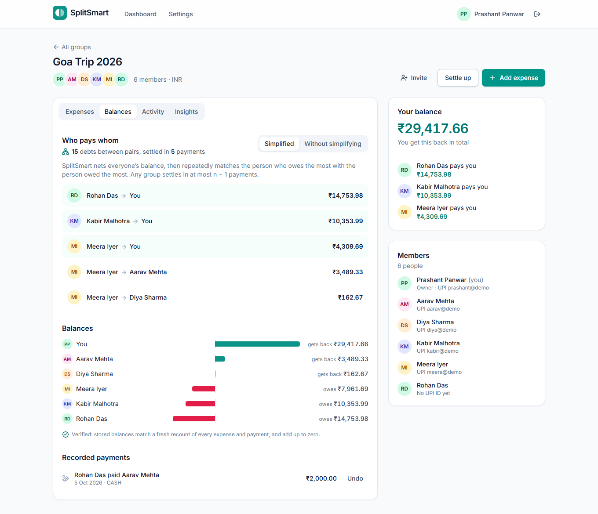
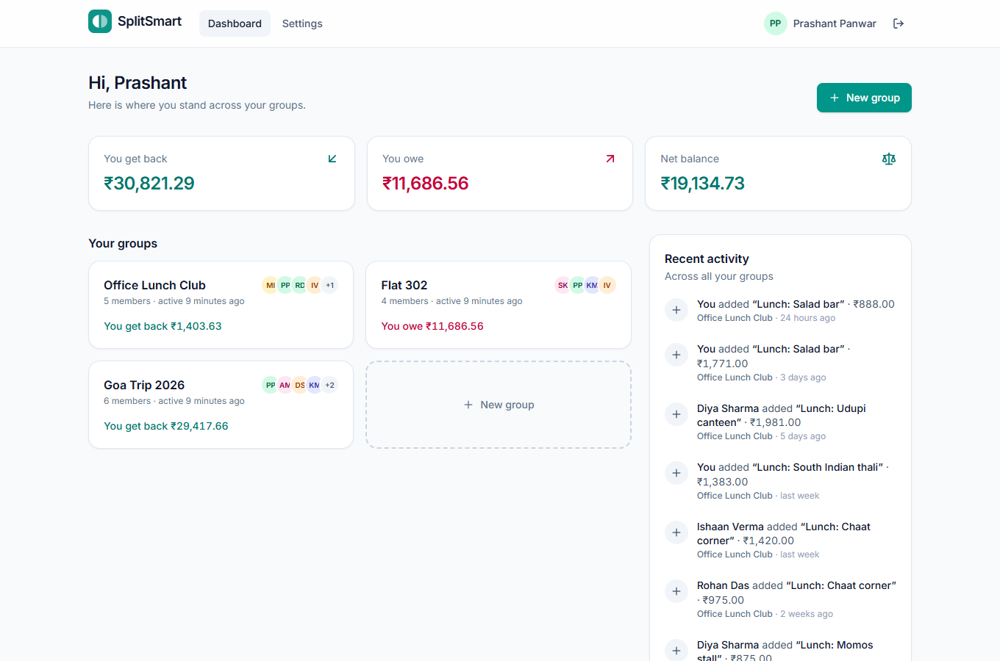
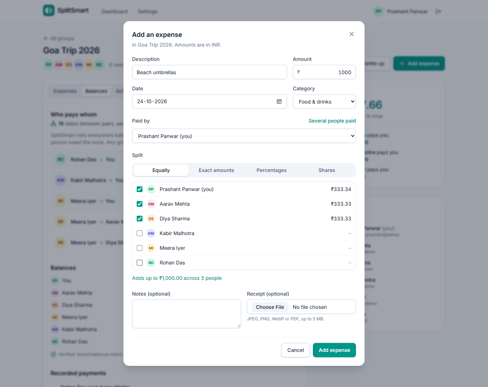
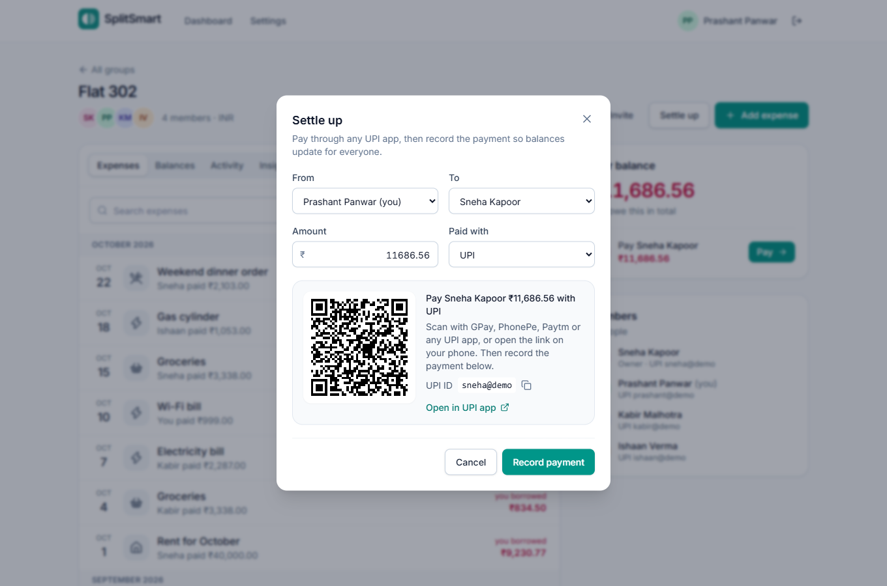
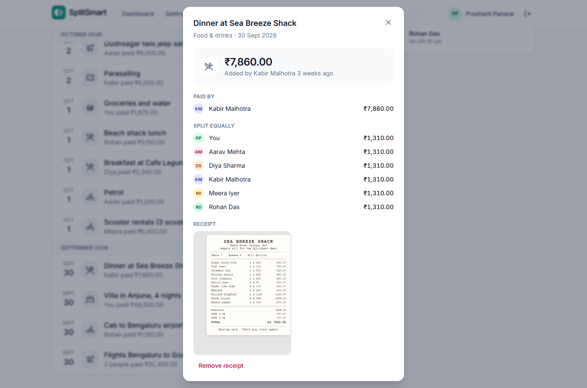
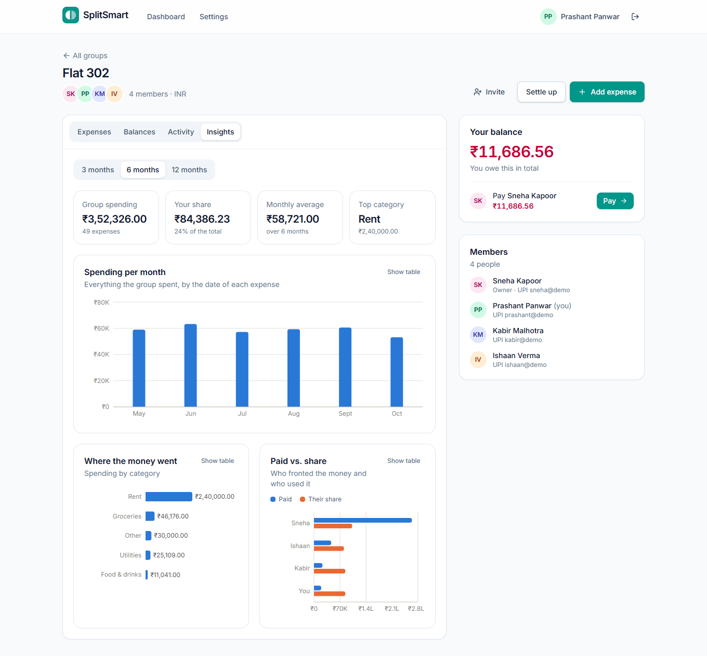
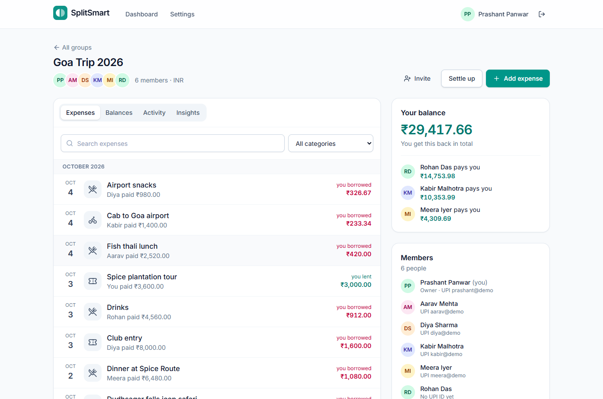
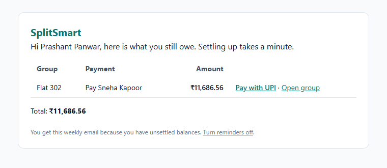
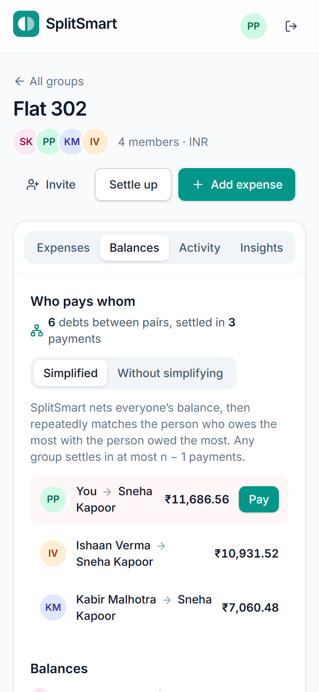
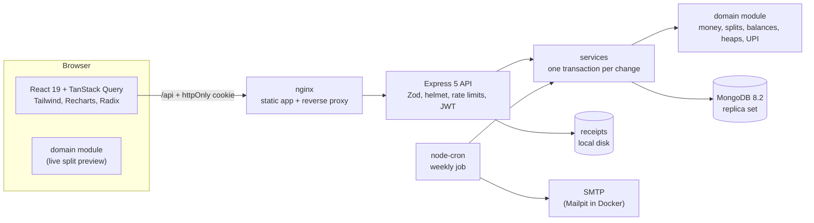

# SplitSmart: Split Group Expenses, Settle Up in Fewer Payments

[](https://github.com/Prashant-Best/splitsmart/actions/workflows/ci.yml)


SplitSmart is a Splitwise-style app for trips, flatmates and friend groups. Add shared bills
(split equally, by exact amounts, by percentages or by shares, with one or several payers), see
who owes whom, and settle up with a **UPI link or QR code** in the **fewest payments**.

> On the demo Goa trip, 18 expenses between 6 friends leave 15 debts between pairs. SplitSmart's
> heap-based simplification settles the group in **5 payments**, the true minimum found by brute
> force. Across 10,000 random groups it matched the exact optimum **99.98%** of the time and never
> needed more than **n − 1** payments. Money is stored as **integer paise**, every balance change
> is a **MongoDB transaction**, and **17 fast-check properties (17,000 random cases per run)** plus
> a database-backed property test check that a group's balances always sum to exactly zero.



## Features

- **Groups** with invite links (owners can reset a leaked link), member list and group currency.
- **Expenses** split equally, by exact amounts, by percentages (two decimals) or by shares, with
  one or several payers, a category, notes and a **receipt photo or PDF**.
- **Live split preview**: the form shows everyone's share as you type, computed by the same code
  the server stores (shared domain module).
- **Balances**: each member's net position as diverging bars, plus "you owe / you get back" per
  person, and a badge confirming the stored balances match a fresh recount of the ledger.
- **Debt simplification**: who pays whom in at most n − 1 payments, with a toggle to compare
  against the unsimplified pairwise debts.
- **Settle up** with a `upi://pay` deep link and QR code (GPay, PhonePe, Paytm, BHIM), then
  record the payment. Payments can be undone.
- **Activity feed** per group and across groups, and **field-level edit history** per expense.
- **Spending insights**: monthly totals, categories, and paid vs. share per member, each chart
  with a table view.
- **Weekly email reminders** (node-cron + Nodemailer) to everyone who owes money, with UPI links;
  at most one per person per week even if the job runs twice.

| Dashboard | Add an expense (live split preview) |
|---|---|
|  |  |
| **Settle up with UPI** | **Expense detail, receipt and edit history** |
|  |  |
| **Spending insights** | **Expenses by month** |
|  |  |
| **Weekly reminder email** | **On a phone** |
|  |  |

## How debt simplification works

Every expense changes each person's **net balance**: payers go up by what they paid, participants
go down by their share. Positive means the group owes you; negative means you owe. Settling up only
needs these net balances, not the history of who paid for what.

```
put everyone owed money into a max-heap of creditors, keyed by amount
put everyone who owes into a max-heap of debtors, keyed by amount
while both heaps are non-empty:
    c = pop largest creditor;  d = pop largest debtor
    pay = min(c.amount, d.amount)
    record "d pays c pay"
    push back whichever of c, d still has money left
```

- **At most n − 1 payments.** Each round settles at least one person completely and the last round
  settles two, because the totals match.
- **Time O(n log n), space O(n)**: at most n − 1 rounds, each a constant number of heap operations.
  Simplifying 100,000 balances takes roughly 60–200 ms on a laptop ([benchmark](docs/benchmark.md)).
- **Deterministic**: ties are broken by user id, so everyone sees the same plan.

Example (amounts in ₹): Asha −500, Bala −300, Chirag +600, Dev +200 →
Asha pays Chirag 500; Bala pays Dev 200; Bala pays Chirag 100. Three payments for four people.

**It is a heuristic, and the README is honest about that.** Finding the true minimum is NP-hard:
the minimum is n minus the largest number of disjoint sub-groups whose balances sum to zero. For
balances +600, +500, −500, −400, −200 the greedy plan pairs 600 with 500 first and needs 4
payments, while {+500, −500} and {+600, −400, −200} settle separately in 3. `optimal.ts` computes
the exact minimum with a bitmask DP over subsets (O(2ⁿ·n)) to measure the gap; it is never used
in requests.

## Money: integer paise

- Every amount is an integer number of paise. Inputs like `"4.35"` are parsed from the string
  straight into `435`; with floats, `4.35 * 100` is `434.99999999999994`.
- Splits use the **largest-remainder method**: everyone gets `floor(total × weight / Σweights)`,
  and the few leftover paise go to the largest remainders, ties by user id. Shares always add up
  to the exact total, each is within one paisa of its exact value, and the result does not depend
  on the order people were listed in. BigInt keeps `total × weight` exact.
- ₹1,000.00 split three ways is ₹333.34 + ₹333.33 + ₹333.33, always the same person getting the
  extra paisa.

## Consistency: one transaction per change

```
POST /api/groups/:id/expenses
  Zod checks the shape ─► domain checks the arithmetic (payers and shares must add up) ─► 400 if not
  └─► MongoDB transaction (snapshot reads, majority writes; the driver retries write conflicts)
        1. insert the expense
        2. $inc every affected member's balance by (paid − share)   one atomic update with array filters
        3. re-read the group: balances must still sum to 0           otherwise abort
        4. insert the activity entry
      commit ─► 201
```

- **Edits** apply `new effect − old effect` inside the transaction and require the version the
  edit started from, so a stale form gets **409** instead of overwriting someone's change.
- **Deletes** are soft (history and the feed keep their meaning) and reverse the balances in the
  same transaction.
- The balances endpoint reads the group and the whole ledger in **one snapshot** and reports
  whether the stored balances equal a fresh recount (`consistent: true`).

## Architecture



The domain module (`server/src/domain`) is pure TypeScript with no I/O. The API stores its
results; the client imports the same files through a Vite alias for the live preview; the property
tests run against it without a database.

## Results

**Debt simplification** ([full report](docs/benchmark.md), `npm run benchmark`)

| Demo group | Members | Expenses | Pairwise debts | Simplified payments | Exact minimum |
|---|---|---|---|---|---|
| Goa Trip 2026 | 6 | 18 | 15 | **5** | 5 |
| Flat 302 (6 months) | 4 | 49 | 6 | **3** | 3 |
| Office Lunch Club | 5 | 20 | 10 | **4** | 4 |

| 10,000 random groups (n = 4…12, 3n expenses each) | Greedy = exact optimum | Payments saved vs. pairwise |
|---|---|---|
| Everyone shares expenses | **99.98%** | 78% |
| Two separate friend circles in one group | 47.22% (always within 1 payment) | 52% |

**Tests** (all offline; CI runs them on every push)

| Suite | Tests | What it covers |
|---|---|---|
| Server unit (Jest) | 92 | money parsing and formatting, heap, splits, balances, simplification, exact solver, UPI links; 17 fast-check properties × 1,000 cases |
| Server integration (Jest + supertest + in-memory replica set) | 63 | auth and sessions, groups and invites, expenses, settlements, receipts, activity, stats, reminders, rollback, 25 concurrent writes, 40 random operation sequences checked against the ledger |
| Client (Vitest + Testing Library) | 23 | form logic, live preview, exact request bodies, UPI QR dialog |

Server statement coverage: **95.1%** (lines 96.8%). Property testing also found a real bug during
development: splitting each share across several payers separately could drop a paisa from one
payer and give it to another. The fix is in `server/src/domain/balances.ts`, with a regression
test in `server/tests/unit/balances.test.ts`.

## Quick start

Requirements: Node 22.12+ (developed on Node 24). **No MongoDB install needed**: `npm run dev`
starts a persistent single-node replica set from the MongoDB binary that `mongodb-memory-server`
downloads once.

```bash
git clone https://github.com/Prashant-Best/splitsmart.git
cd splitsmart
npm run setup      # installs root, server and client dependencies
npm run dev        # MongoDB replica set :27017 + API :4000 + web app :5173
npm run seed       # in a second terminal: demo groups (resets the dev database)
```

Open http://localhost:5173 and click **Use the demo account** (`prashant@example.com` /
`splitsmart-demo`; every demo user has this password). Settings can go in `server/.env`
(see `server/.env.example`); without `SMTP_URL`, emails are saved as HTML files in `server/.outbox/`.

**Docker** (MongoDB replica set + API + nginx + Mailpit):

```bash
docker compose up -d --build
docker compose --profile tools run --rm seed    # optional demo data
# App: http://localhost:8080   Caught emails: http://localhost:8025
```

**Other commands**

```bash
npm test                                   # server and client tests
npm run test:coverage --prefix server
npm run benchmark --prefix server          # writes docs/benchmark.md
npm run reminders:send --prefix server     # run the weekly reminder job now
npm run screenshots                        # regenerate docs/screenshots (uses installed Edge/Chrome)
bash scripts/smoke-test.sh http://localhost:8080   # end-to-end check of a running stack
```

## API

All amounts are integer paise. Errors share one shape: `{ "error": { "code", "message", "details"? } }`.

| Method | Endpoint | Description |
|---|---|---|
| POST | `/api/auth/register`, `/api/auth/login` | Create an account / sign in (sets an httpOnly session cookie) |
| POST | `/api/auth/logout`, `/api/auth/logout-all` | Sign out / sign out of every device |
| GET, PATCH | `/api/auth/me` | Profile: name, UPI ID, reminder preference |
| GET, POST | `/api/groups` | Your groups with your balance / create a group |
| GET, PATCH | `/api/groups/:groupId` | Members, balances, invite code / rename (owner) |
| POST | `/api/groups/:groupId/invite/reset` | New invite link (owner) |
| GET, POST | `/api/invites/:code`, `/api/invites/:code/join` | Preview / join through an invite link |
| GET, POST | `/api/groups/:groupId/expenses` | List (keyset pagination, search, category) / add |
| GET, PUT, DELETE | `/api/groups/:groupId/expenses/:expenseId` | Detail with history / edit (version check) / delete |
| POST, GET, DELETE | `/api/groups/:groupId/expenses/:expenseId/receipt` | Upload (≤ 5 MB) / view (members only) / remove |
| GET | `/api/groups/:groupId/balances` | Balances, simplified plan, pairwise debts, ledger check |
| GET, POST | `/api/groups/:groupId/settlements` | Recorded payments / record a payment |
| DELETE | `/api/groups/:groupId/settlements/:settlementId` | Undo a payment |
| GET | `/api/groups/:groupId/activity`, `/api/activity` | Activity feed (cursor pagination) |
| GET | `/api/groups/:groupId/stats?months=6` | Spending by month, category and member |
| GET | `/api/health` | Status and database connection |

## Project structure

```
splitsmart/
├── server/
│   ├── src/domain/       money, splits, balances, heap, simplify, optimal, upi (pure, shared)
│   ├── src/models/       User, Group (members + balances), Expense, Settlement, Activity, ReminderLog
│   ├── src/services/     ledger (transactions), expenses, settlements, groups, stats, reminders, storage
│   ├── src/routes/       Express routers;  src/middleware/  auth, group access, errors, rate limits
│   ├── src/jobs/         weekly reminder scheduler
│   ├── scripts/          dev-db, seed + demo data, benchmark, send-reminders
│   └── tests/            unit (incl. fast-check) and integration (in-memory replica set)
├── client/src/
│   ├── api/              typed fetch client and TanStack Query hooks
│   ├── components/       expense form, balances, settle up, insights, activity, UI primitives
│   ├── lib/              formatting, expense form logic, chart theme
│   └── pages/            dashboard, group, join, settings, sign in
├── docs/                 benchmark report and screenshots
├── scripts/              smoke-test.sh, screenshots.mjs
├── docker-compose.yml    MongoDB replica set, API, nginx web app, Mailpit
└── .github/workflows/    CI: lint, types, format, tests, builds, Docker smoke test
```

## Design decisions

| Decision | Why |
|---|---|
| Integer paise, never floating-point rupees | Exact arithmetic; `0.1 + 0.2` and `4.35 * 100` style errors cannot reach a balance |
| Largest-remainder rounding with id tie-breaks | Shares always add up to the total and are reproducible on any machine |
| Balances stored on the group, updated in transactions | Reads are O(members); the expense, balances and activity entry commit together or not at all |
| Zero-sum check inside each transaction | A bug can fail one request but can never commit corrupted balances |
| Optimistic concurrency (`version`) on edits | Two people editing the same expense cannot silently overwrite each other |
| Pure domain module shared with the client | One implementation for the preview and the stored result; fast tests without a database |
| Greedy two-heap simplification | O(n log n), provably ≤ n − 1 payments, easy to explain; the exact optimum is NP-hard |
| httpOnly, SameSite=Lax session cookie + token version | Not readable by scripts (XSS), not sent on cross-site POSTs (CSRF), "sign out everywhere" works |
| Same-origin serving (nginx or Vite proxy) | No CORS or third-party-cookie issues |
| Receipts behind a members-only route | Never public files; type checked from magic bytes; random keys prevent path traversal |
| Unique (user, week) reminder log | The cron job is idempotent, safe to retry or run on several instances |
| Keyset pagination on (group, date, _id) | Stable pages while new expenses arrive; served by an index |
| Soft deletes | History and the activity feed stay meaningful; balances are still reversed atomically |

## Limitations and next steps

- **Greedy is not always optimal** when a group contains independent sub-circles (optimal in 47% of
  such random groups, always within one payment). Next: settle each connected component of the
  expense graph separately, or use the exact DP for groups of up to ~15 people.
- **Payments are recorded on trust**: a UPI deep link cannot report back whether the transfer
  happened. Next: let the receiver confirm, or use a payment gateway's UPI collect flow.
- One currency per group; no exchange rates.
- Receipts are stored on local disk; several API instances would need object storage
  (`ReceiptStorage` is an interface ready for Cloudinary or S3).
- Not deployed yet; the plan is Vercel (web) + Render (API) + MongoDB Atlas, with Vercel rewrites
  keeping the API same-origin.
- Members cannot leave a group yet (it should require a zero balance).

## Tech stack

**Client:** React 19, TypeScript, Vite, TanStack Query, React Router, Tailwind CSS, Radix UI,
Recharts, qrcode.react, Vitest, Testing Library.
**Server:** Node.js, Express 5, TypeScript, MongoDB 8.2 (Mongoose, transactions), Zod, JWT,
bcrypt, helmet, express-rate-limit, multer, node-cron, Nodemailer, pino, Jest, fast-check,
supertest, mongodb-memory-server.
**Ops:** Docker, Docker Compose, nginx, Mailpit, GitHub Actions.

---

Built by **Prashant Panwar**, B.Tech CSE (Minor: Data Science), Lovely Professional University.
